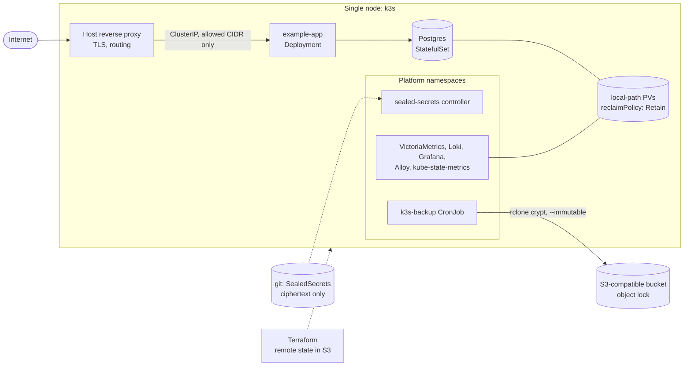

# k3s-platform

A sanitized reference of a real single-node k3s production platform: host
bootstrap, platform layer (storage, sealed secrets, network policies,
monitoring, encrypted immutable backups) and one generic app module, all in
Terraform. Snapshot as of November 2026.

> **Reference architecture, not a turnkey module. Not deployable as-is.**
> The structure and the engineering decisions are real; every value (domains,
> bucket names, endpoints, registry paths, CIDRs, namespaces, secrets) is a
> placeholder. Read it, copy the parts you want, adapt them. It is a one-time
> snapshot and is not kept in sync with anything.

## Architecture



## Layout

```
host/k3s/            install.sh (pinned version + sha256 checks), config.yaml
terraform/10-platform/   storage, sealed-secrets, network policies, monitoring, backup
  values/            Helm values (images pinned by digest, resource limits)
  files/             Alloy pipeline
  vendor/            unmodified upstream local-path-provisioner manifest
terraform/20-apps/       root that instantiates app modules
  example-app/       Postgres StatefulSet, Deployment, Service, NetworkPolicies, SealedSecrets
docs/restore.md      backup contents and restore runbook
.github/workflows/   fmt, validate, tflint, gitleaks
```

## Design decisions and trade-offs

- **Single node, on purpose.** One small VPS. HA would multiply cost and
  operational surface for workloads that tolerate a restore window. The price:
  the node is a single point of failure, so recovery (not redundancy) is the
  strategy, and the backup and restore path is treated as a first-class
  component. Everything is sized with requests/limits to fit one small box
  (monitoring requests total roughly 1 GiB).
- **k3s.** One binary, sqlite datastore (no etcd cluster to run), good enough
  defaults. Traefik, servicelb and local-storage are disabled: the host proxy
  is the only entry point, there is no LoadBalancer, and storage is an explicit
  choice. Secrets encryption at rest is on.
- **Verified bootstrap.** `install.sh` pins the k3s version, verifies the
  binary against the release's sha256 file, verifies the upstream installer
  against a pinned hash, and refuses to run if the live config drifted from the
  repo.
- **Remote state with native locking.** Terraform state lives in an
  S3-compatible bucket with `use_lockfile` (conditional writes), no extra
  lock table. Credentials come from the environment only.
- **Sealed-secrets over an external secret store.** Encrypted manifests live in
  git next to the code, no extra always-on service or SaaS dependency on a
  small box. Trade-off: the controller's master keys become the crown jewels,
  so they are backed up off the node every day (`docs/restore.md`), and secrets
  are scoped `strict` to name and namespace.
- **Default-deny.** Every namespace starts with deny-all ingress; allow rules
  are explicit per source and port. The database accepts only the app. All
  services are ClusterIP; operators use `kubectl port-forward` over an SSH
  tunnel to the API.
- **Immutable, encrypted backups.** rclone `crypt` (client-side), `copy` never
  `sync`, `--immutable`, bucket object lock, `cryptcheck` after upload, sqlite
  `integrity_check` before it. A compromised node can add backups but not erase
  recent ones, and the bucket never sees plaintext.
- **Storage with Retain.** local-path-provisioner as default StorageClass with
  `reclaimPolicy: Retain`: deleting a PVC or Helm release never deletes data.
  The upstream manifest is vendored unmodified (with URL and checksum) and only
  the needed fields are overridden in Terraform.
- **Pinning.** Helm chart versions are pinned in Terraform, container images by
  digest (public upstream digests are real; private images are placeholders),
  k3s by version plus checksums. Upgrades are explicit diffs.
- **Resource limits.** Memory requests and limits on every platform pod, so one
  misbehaving component is OOM-killed instead of starving the node.

## Restore

Backups contain the sealed-secrets keys and the k3s datastore (state, token,
encryption config, TLS). See [docs/restore.md](docs/restore.md) for contents,
protections, setup and the step-by-step restore.

## Using it as a reference

Terraform `~> 1.16`, providers `kubernetes ~> 3.3` and `helm ~> 3.3`. CI runs
`terraform fmt`, `init -backend=false` + `validate` on both roots, tflint and
gitleaks. Nothing here has been, or should be, applied without replacing the
placeholders first.

## License

Apache-2.0, see [LICENSE](LICENSE). Copyright 2026 Victor Dias Gonçalves.
